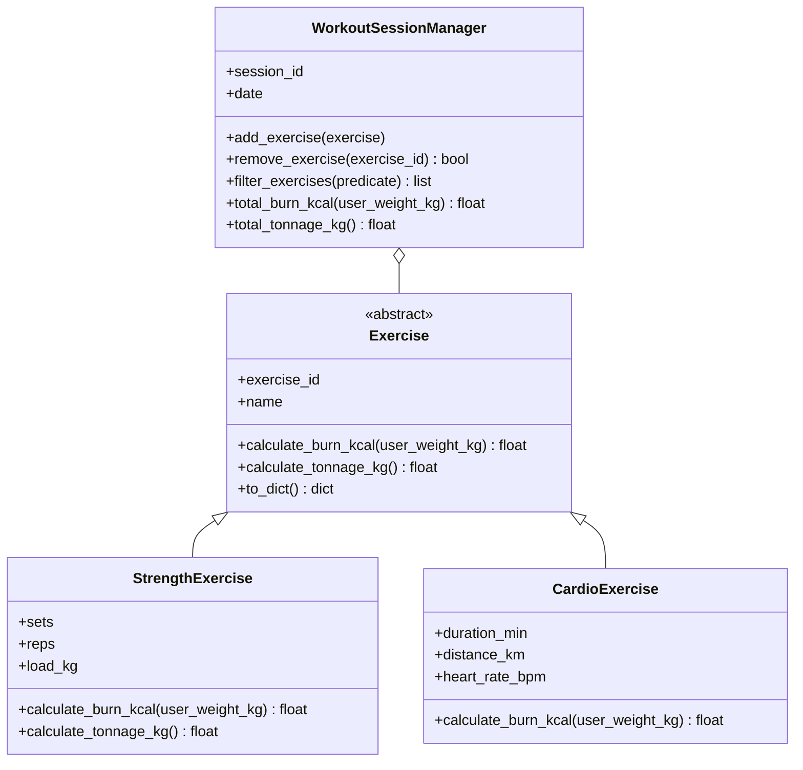

# Sprawozdanie z Zadania Laboratoryjnego nr 3

**Przedmiot:** Programowanie w języku Python (`IwIK-S1`), Laboratorium 3.2  
**Zespół:** 2  
**Projekt:** FitTrack Pro — dziennik treningowy i kalorii  
**Dawid Mucha:** nr albumu 164852, login Git `dawidmuchapk`  
**Dawid Sałek:** nr albumu do uzupełnienia, login Git `dawidsalek6`  
**Data oddania:** do uzupełnienia

----

## 1. Cel i zakres zadania

Celem projektu jest konsolowa aplikacja FitTrack Pro do zapisywania treningów siłowych, spożycia makroskładników i czasu przerw między ćwiczeniami. Program udostępnia menu, waliduje dane wejściowe, zapisuje je w plikach CSV i JSON oraz generuje podsumowania dzienne i tygodniowe.

W Zadaniu 3 model treningowy został oparty na abstrakcyjnym kontrakcie `Exercise`. Ćwiczenia siłowe i cardio implementują wspólną metodę obliczania szacowanego wydatku energetycznego. `WorkoutSessionManager` zarządza kolekcją ćwiczeń, oblicza sumę kalorii i tonaż, a także obsługuje serializację polimorficznej kolekcji do JSON.

---

## 2. Architektura i hierarchia klas



| Moduł lub plik | Odpowiedzialność |
| --- | --- |
| `main.py` | Pętla programu, menu i przekazywanie wyboru do funkcji usługowych. |
| `services.py` | Rejestracja treningów i posiłków, stoper oraz podsumowania dnia i tygodnia. Rejestrowane ćwiczenia siłowe trafiają do CSV i do menedżera sesji JSON. |
| `models.py` | Abstrakcyjna klasa `Exercise`, podklasy `StrengthExercise` i `CardioExercise` oraz `WorkoutSessionManager`. Zawiera reguły walidacji, obliczenia, dyskryminator typów i fabrykę odczytu. |
| `storage.py` | Odczyt i zapis plików CSV i profilu JSON oraz repozytorium menedżerów sesji treningowych. |
| `validators.py` | Walidacja liczb i niepustych napisów wpisywanych w konsoli. |
| `data.py` | Dane przykładowe oraz stan stopera w bieżącej sesji programu. |
| `test_manager.py` | Testy kontraktu abstrakcyjnego, podklas, menedżera, JSON, repozytorium i wartości brzegowych. |
| `data/workouts.csv` | Zapis treningów siłowych w formacie CSV. |
| `data/nutrition.csv` | Zapis posiłków i makroskładników w formacie CSV. |
| `data/user_profile.json` | Profil użytkownika i dzienne cele żywieniowe. |
| `data/workout_sessions.json` | Zagnieżdżone sesje i ćwiczenia z dyskryminatorem typu; plik powstaje przy pierwszym zapisie sesji. |

### Kontrakt i polimorfizm

`Exercise` dziedziczy po `ABC` i wymaga implementacji `calculate_burn_kcal(user_weight_kg)`. Nie można utworzyć jej bezpośrednio. `StrengthExercise` przechowuje serie, powtórzenia i obciążenie, a `CardioExercise` — czas, dystans i tętno. Obie podklasy są inicjalizowane przez `super().__init__()` i sprawdzają poprawność swoich danych.

Menedżer oblicza sumę kalorii przez wywołanie tej samej metody na każdym ćwiczeniu w kolekcji. Nie rozpoznaje podklas instrukcjami `isinstance`; reguła obliczeń znajduje się w obiekcie ćwiczenia. Tonaż ćwiczeń siłowych wynosi `serie × powtórzenia × obciążenie`. Ćwiczenia cardio nie wnoszą tonażu, więc zwracają `0 kg` dla tej metryki.

Wartości kalorii są uproszczonymi szacunkami przyjętymi na potrzeby projektu, ponieważ specyfikacja nie podaje wzorów:

- siłowe: `(masa użytkownika + obciążenie) × serie × powtórzenia × 0,01`;
- cardio: `masa użytkownika × czas w minutach × tętno / 1000`.

Każdy słownik ćwiczenia zawiera klucz `type` o wartości `strength` albo `cardio`. `Exercise.from_dict()` używa rejestru klas `EXERCISE_REGISTRY`, aby odtworzyć właściwą podklasę bez łańcucha instrukcji `if/elif`. Nieznany typ powoduje `ValueError`.

`WorkoutSessionManager` zarządza kolekcją ćwiczeń: umożliwia dodawanie, usuwanie i filtrowanie oraz oblicza sumę kalorii i tonaż. `WorkoutSessionRepository` w `storage.py` oddziela zapis i odczyt sesji JSON od interfejsu CLI.

---

## 3. Kluczowy fragment kodu i uzasadnienie inżynierskie

Najważniejszym elementem jest dynamiczne wywołanie metody na elementach kolekcji. Menedżer nie musi znać klas konkretnych ćwiczeń, a dodanie nowej podklasy z własną implementacją kontraktu nie wymaga dopisywania kolejnej gałęzi warunkowej w menedżerze.

```python
def total_burn_kcal(self, user_weight_kg: float) -> float:
    return round(sum(
        exercise.calculate_burn_kcal(user_weight_kg)
        for exercise in self._exercises
    ), 2)


def total_tonnage_kg(self) -> float:
    return round(sum(
        exercise.calculate_tonnage_kg()
        for exercise in self._exercises
    ), 2)
```

Rozwiązanie łączy abstrakcję, dziedziczenie, polimorfizm i kompozycję. Reguły biznesowe są umieszczone w modelu, kolekcją zarządza menedżer, a obsługa trwałego zapisu jest wydzielona do repozytorium.

---

## 4. Weryfikacja i wyniki testów

Testy uruchamia się z katalogu `src`:

```text
python test_manager.py
```

Weryfikacja w środowisku projektu zakończyła się powodzeniem: wszystkie 6 grup testów przeszło.

| Nr | Scenariusz | Sprawdzany wynik |
| --- | --- | --- |
| 1 | Kontrakt abstrakcyjny i podklasy | `Exercise` nie daje się utworzyć bez implementacji metody abstrakcyjnej; podklasy liczą tonaż zgodnie ze swoim typem. |
| 2 | Polimorficzne obliczenia menedżera | Dla 70 kg użytkownika: przysiad 3×10 z obciążeniem 40 kg daje 33 kcal, bieg 30 min przy tętnie 140 bpm daje 294 kcal; menedżer sumuje 327 kcal i 1200 kg tonażu. |
| 3 | Operacje na kolekcji | Filtrowanie zwraca ćwiczenia z tonażem, a usuwanie znajduje element po ID i zgłasza, czy go usunęło. |
| 4 | Dyskryminator i round-trip JSON | Wartości `strength` i `cardio` odtwarzają właściwe podklasy; nieznany typ jest odrzucany. |
| 5 | Repozytorium sesji | Zapis, odczyt i usunięcie sesji w JSON zachowują strukturę agregatu. |
| 6 | Dane brzegowe | Niepoprawne serie, powtórzenia, obciążenie, czas, dystans i tętno są odrzucane. |

Przykładowe wyjście skryptu:

```text
TEST 1 - test_kontrakt_abstrakcyjny_i_podklasy: OK
TEST 2 - test_polimorficzne_kalkulacje_menedzera: OK
TEST 3 - test_operacje_na_kolekcji: OK
TEST 4 - test_dyskryminator_json_i_round_trip: OK
TEST 5 - test_repozytorium_sesji_json: OK
TEST 6 - test_dane_brzegowe: OK

Wszystkie 6 testów zakończone powodzeniem!
```

---

## 5. Podział pracy i historia Git

Poniższe obszary opisują dotychczasową odpowiedzialność w projekcie. Historia zawiera także zmiany współdzielone; same liczby commitów nie określają dokładnie czasu ani zakresu pracy przy każdej funkcji.

| Osoba / login Git | Główne obszary projektu | Liczba commitów w dostępnej historii |
| --- | --- | ---: |
| Dawid Mucha (`dawidmuchapk`) | Modele, walidacja, dane przykładowe oraz część zapisu i podsumowań. | 10 |
| Dawid Sałek (`dawidsalek6`) | Menu, usługi aplikacji i część warstwy zapisu/odczytu. | 18 |
| Autor `dawid` | Jeden commit; przypisanie konta do członka zespołu wymaga potwierdzenia. | 1 |

Historia commitów nie jest równomierna: zawiera 10 commitów `dawidmuchapk` i 18 commitów `dawidsalek6`, a jeden commit ma autora `dawid`. Przed oddaniem należy potwierdzić, do kogo należy to konto, opisać rzeczywisty wkład obu osób, uzupełnić numer albumu Dawida Sałka i wpisać właściwą datę oddania. Nie przypisano niepotwierdzonego commitu do żadnego członka zespołu.
